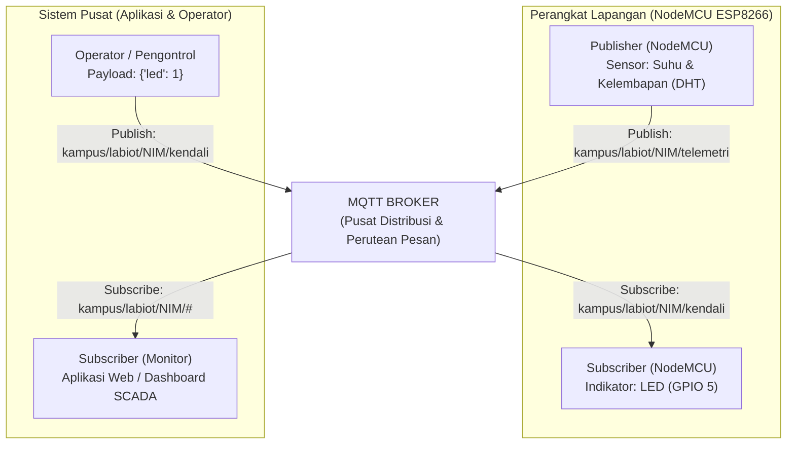
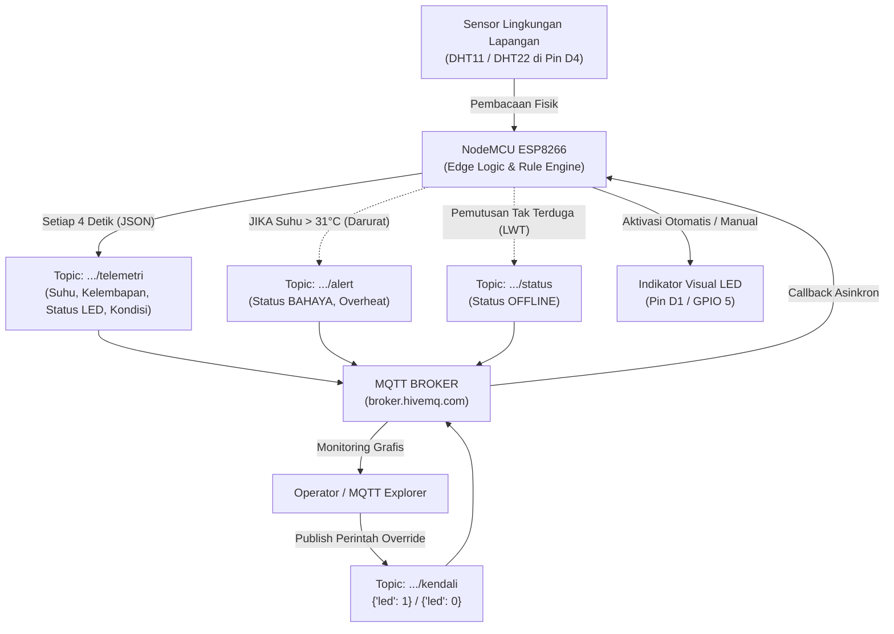

# **Modul 6: Protokol Komunikasi Telemetri Industri (MQTT)**

## **6.1 Pengantar**

Pada Modul 3 dan Modul 4, kita telah mempelajari komunikasi nirkabel berbasis protokol HTTP dan WebSockets, sementara pada Modul 5 kita mengeksplorasi topologi terdesentralisasi berbasis ESP-NOW dan jaringan *mesh*. Namun, pada implementasi skala industri dan sistem *cloud* modern yang melibatkan ribuan hingga jutaan perangkat (*Large-Scale Internet of Things*), protokol berbasis *Request-Response* (seperti HTTP) maupun koneksi point-to-point lokal memiliki keterbatasan besar dalam efisiensi penggunaan *bandwidth*, konsumsi energi, dan skalabilitas perutean data.

Untuk menjawab tantangan tersebut, modul ini memperkenalkan standar *de facto* komunikasi telemetri data industri: **MQTT (Message Queuing Telemetry Transport)**. Dirancang khusus untuk lingkungan dengan sumber daya komputasi terbatas dan jaringan nirkabel yang rentan gangguan, MQTT mengusung arsitektur **Publish-Subscribe** yang dimediasi oleh perantara cerdas (*MQTT Broker*). Pada praktikum ini, mahasiswa akan merancang sistem telemetri sensor lingkungan (suhu dan kelembapan) terstruktur berformat JSON, membangun penanganan kendali indikator LED asinkron dua arah (*full-duplex*), menerapkan mekanisme pemulihan koneksi dan sinyal darurat *Last Will and Testament* (LWT), serta menguji seluruh alur komunikasi menggunakan perangkat lunak diagnostik industri secara mandiri.

---

## **6.2 Tujuan Pembelajaran**

* Mahasiswa mampu menjelaskan arsitektur komunikasi *Publish-Subscribe*, peran sentral MQTT *Broker*, konsep hierarki *Topic*, dan tingkat jaminan pengiriman (*Quality of Service* / QoS).
* Mahasiswa mampu menginstal dan mengonfigurasi pustaka `PubSubClient` serta `ArduinoJson` pada lingkungan Arduino IDE.
* Mahasiswa mampu menyusun (*serialize*) data pembacaan sensor suhu dan kelembapan (DHT11/DHT22) ke dalam paket terstruktur JSON dan memublikasikannya secara periodik tanpa memblokir sistem (*non-blocking timer* berbasis `millis()`).
* Mahasiswa mampu memproses (*deserialize*) paket data JSON yang masuk melalui fungsi *callback* MQTT untuk mengendalikan indikator LED secara asinkron.
* Mahasiswa mampu menerapkan fitur keandalan industri seperti pemulihan koneksi otomatis (*auto-reconnect*) dan pesan status darurat *Last Will and Testament* (LWT).
* Mahasiswa mampu menguji, memantau, dan menganalisis lalu lintas telemetri dua arah secara mandiri menggunakan peranti lunak industri (*MQTT Explorer* atau *HiveMQ Web Client*).

---

## **6.3 Teori Dasar**

### **6.3.1 Arsitektur Publish-Subscribe (MQTT)**

Berbeda dengan protokol HTTP yang mengharuskan klien meminta data secara aktif kepada peladen (*Request-Response*), MQTT beroperasi menggunakan model komunikasi **Publish-Subscribe**. Protokol ini dirancang oleh Dr. Andy Stanford-Clark (IBM) dan Arlen Nipper (Arcom) pada tahun 1999 untuk memantau pipa minyak melintasi jaringan satelit yang mahal dan berkecepatan rendah. Saat ini, MQTT menjadi standar internasional (ISO/IEC 20922 dan OASIS) untuk ekosistem *Smart City*, industri manufaktur (Industrial IoT / IIoT), dan platform *cloud* (seperti AWS IoT, Google Cloud IoT, dan Microsoft Azure IoT).



Karakteristik arsitektur *Publish-Subscribe* dibangun di atas tiga prinsip pemisahan (*decoupling*):

1. **Spatial Decoupling (Pemisahan Ruang):** Pengirim (*Publisher*) dan penerima (*Subscriber*) tidak perlu saling mengetahui alamat IP atau identitas fisik masing-masing. Keduanya hanya perlu terhubung ke *Broker* yang sama.
2. **Temporal Decoupling (Pemisahan Waktu):** Pengirim dan penerima tidak harus aktif pada detik yang persis sama. Jika fitur *Retain Message* atau *Persistent Session* diaktifkan, *Broker* dapat menyimpan pesan hingga penerima kembali aktif.
3. **Synchronization Decoupling (Pemisahan Sinkronisasi):** Pengiriman dan penerimaan data terjadi secara asinkron tanpa memblokir operasi kerja utama mikrokontroler.

**Tabel Perbandingan Karakteristik Protokol IoT:**

| Parameter | HTTP / REST | WebSockets | MQTT |
| :--- | :--- | :--- | :--- |
| **Model Komunikasi** | *Request - Response* | *Full-Duplex Peer-to-Peer* | *Publish - Subscribe* (Terpusat) |
| **Beban Header (*Overhead*)** | Besar ($\approx 200 - 800\ \text{byte}$) | Sedang ($\approx 2 - 10\ \text{byte}$) | Sangat Kecil ($\text{minimal } 2\ \text{byte}$) |
| **Tingkat Skalabilitas** | Rendah - Menengah | Menengah | Sangat Tinggi (Jutaan *Node*) |
| **Konsumsi Bandwidth & Daya** | Boros | Efisien | Sangat Efisien & Hemat Energi |
| **Perantara Jaringan** | *Web Server* | *Web Server* | *MQTT Broker* |

---

### **6.3.2 Hierarki Topik (*Topic Hierarchy*) dan Karakter Wildcard**

Pada MQTT, pesan tidak dialamatkan ke nomor port atau alamat IP perangkat, melainkan disalurkan berdasarkan label teks berjenjang yang disebut **Topik (*Topic*)**. Setiap tingkatan hierarki dipisahkan oleh tanda garis miring (`/`). Topik bersifat dinamis dan tidak perlu didaftarkan terlebih dahulu di *Broker*.

**Konvensi Penamaan Standar Industri:**

$$
\text{Topik} = \text{domain}/\text{lokasi}/\text{id\_perangkat}/\text{fungsi\_data}
$$

*Contoh Penerapan:*
* `kampus/gedunga/mhs_123456/telemetri` (Data pembacaan sensor berkala).
* `kampus/gedunga/mhs_123456/kendali` (Instruksi pemicuan aktuator).
* `kampus/gedunga/mhs_123456/status` (Laporan status koneksi perangkat).

**Karakter Pencocokan Wildcard (Khusus Subscriber):**

Pelanggan (*Subscriber*) dapat memantau beberapa topik sekaligus menggunakan karakter pengganti (*wildcard*):

1. **Plus (`+`) — *Single-Level Wildcard*:**  
   Menggantikan tepat satu tingkat hierarki pada posisi di mana tanda tersebut berada.  
   *Contoh:* Topik `kampus/+/mhs_123456/telemetri` akan menangkap pesan dari:  
   - `kampus/gedunga/mhs_123456/telemetri`  
   - `kampus/gedungb/mhs_123456/telemetri`  
   Tetapi **tidak** akan menangkap:  
   - `kampus/gedunga/lantai1/mhs_123456/telemetri` (karena berbeda dua tingkat).

2. **Pagar (`#`) — *Multi-Level Wildcard*:**  
   Menggantikan seluruh sisa tingkat hierarki turunan. Karakter ini wajib ditempatkan di posisi paling akhir dari string topik.  
   *Contoh:* Topik `kampus/gedunga/#` akan menangkap seluruh pesan yang diawali dengan awalan `kampus/gedunga/`, termasuk `kampus/gedunga/mhs_123456/telemetri`, `kampus/gedunga/ruang1/suhu`, dan seterusnya.

---

### **6.3.3 Tingkat Keandalan Pesan (*Quality of Service* / QoS)**

MQTT menyediakan tiga tingkat jaminan pengiriman pesan (*Quality of Service* / QoS) yang dapat disesuaikan dengan tingkat kepentingan data dan keandalan jaringan:

* **QoS 0 (*At Most Once / Fire and Forget*):**  
  Pesan dikirimkan satu kali tanpa menunggu konfirmasi penerimaan (*acknowledgment*). Sangat cepat dan hemat *bandwidth*, namun terdapat risiko pesan hilang jika sinyal nirkabel terputus.
* **QoS 1 (*At Least Once*):**  
  Pesan dipastikan sampai ke penerima minimal satu kali melalui mekanisme konfirmasi balasan (`PUBACK`). Jika pengirim tidak menerima `PUBACK` dalam batas waktu tertentu, pengirim akan mengirim ulang paket. Berpotensi menghasilkan duplikasi pesan jika jaringan lambat.
* **QoS 2 (*Exactly Once*):**  
  Pesan dijamin sampai tepat satu kali tanpa duplikasi melalui jabat tangan empat tahap (`PUBLISH` $\rightarrow$ `PUBREC` $\rightarrow$ `PUBREL` $\rightarrow$ `PUBCOMP`). Memberikan tingkat keandalan tertinggi, namun membutuhkan *overhead* komputasi dan latensi transmisi paling tinggi.

> **[CATATAN PUSTAKA ESP8266]:** Pustaka standar `PubSubClient` pada mikrokontroler NodeMCU mendukung publikasi dengan **QoS 0** dan **QoS 1**, serta subskripsi pada **QoS 0** secara bawaan guna meminimalkan konsumsi memori SRAM yang terbatas.

---

### **6.3.4 Format Serialisasi Data: JavaScript Object Notation (JSON)**

Memublikasikan setiap variabel sensor ke topik terpisah (misalnya suhu ke `/suhu` dan kelembapan ke `/kelembapan`) memboroskan transmisi paket jaringan serta menyulitkan proses sinkronisasi pembacaan waktu (*temporal alignment*).

Format **JSON** menyatukan seluruh variabel telemetri ke dalam satu paket terstruktur berbasis pasangan Kunci-Nilai (*Key-Value Pairs*):

```json
{
  "node_id": "ESP8266_LabIoT_NIM",
  "suhu": 29.45,
  "kelembapan": 62.10,
  "status_led": 1
}
```

Pustaka `ArduinoJson` menangani dua proses krusial pada mikrokontroler:
1. **Serialisasi (*Serialization*):** Mengonversi variabel program bahasa C++ (`float`, `int`, `char*`) menjadi deretan string teks JSON padat untuk dikirimkan melalui fungsi `client.publish()`.
2. **Deserialisasi (*Deserialization / Parsing*):** Membedah teks JSON yang masuk dari fungsi *callback* MQTT menjadi variabel terpisah yang dapat dievaluasi langsung oleh logika program.

---

### **6.3.5 Fitur Keandalan: Keep-Alive dan Last Will and Testament (LWT)**

Dalam sistem telemetri jarak jauh, mikrokontroler dapat mengalami pemadaman listrik tiba-tiba atau kehilangan sinyal Wi-Fi. Tanpa penanganan khusus, aplikasi pemantau di pusat kendali akan menganggap perangkat masih aktif hingga sesi TCP kedaluwarsa puluhan menit kemudian. MQTT menyediakan dua mekanisme untuk mengatasi kondisi ini:

1. **Keep-Alive Ping:**  
   NodeMCU secara berkala mengirimkan paket pendek `PINGREQ` ke Broker untuk memastikan saluran TCP tetap hidup. Pemeliharaan ini ditangani secara otomatis oleh pemanggilan rutin fungsi `client.loop()`.
2. **Last Will and Testament (LWT):**  
   Saat pertama kali terhubung ke Broker, klien dapat mendaftarkan pesan wasiat (*Will Message*) beserta topik dan tingkat QoS-nya. Jika koneksi klien terputus secara tidak wajar (*ungraceful disconnection*—seperti kabel daya dicabut), Broker akan secara otomatis memublikasikan pesan wasiat tersebut ke topik status agar operator atau sistem pemantau segera mengetahui bahwa simpul tersebut telah *offline*.

---

## **6.4 Persiapan Praktikum**

### **6.4.1 Kebutuhan Perangkat Keras**

Pastikan komponen berikut tersedia di meja kerja Anda:
1. *Board* NodeMCU ESP8266 (1 unit)
2. Kabel Data Micro-USB (1 unit)
3. *Breadboard* / Papan Proyek (1 unit)
4. Sensor Suhu & Kelembapan DHT11 atau DHT22 (1 unit)
5. LED Indikator 5mm (1 unit)
6. Resistor $220\ \Omega$ (1 unit, pembatas arus LED)
7. Kabel *Jumper* tipe *Male-to-Male* dan *Male-to-Female* (secukupnya)

---

### **6.4.2 Persiapan Perangkat Lunak & Pustaka**

1. Buka aplikasi **Arduino IDE**.
2. Masuk ke menu **Sketch > Include Library > Manage Libraries...**.
3. Cari dan instal pustaka berikut:
   * **PubSubClient** oleh Nick O'Leary.
   * **ArduinoJson** oleh Benoit Blanchon (disarankan versi 6.x atau 7.x).
   * **DHT sensor library** oleh Adafruit (beserta dependensi *Adafruit Unified Sensor* jika belum terpasang dari modul sebelumnya).
4. **Alat Uji Telemetri Mandiri (*Diagnostic Testing Tools*):**  
   Siapkan salah satu peranti lunak pengujian MQTT berikut pada laptop Anda:
   * **MQTT Explorer** (Aplikasi desktop gratis lintas platform: [mqtt-explorer.com](https://mqtt-explorer.com)) — **Sangat Direkomendasikan**.
   * **HiveMQ Web Client** (Aplikasi berbasis peramban web: [hivemq.com/demos/websocket-client](https://www.hivemq.com/demos/websocket-client/)).
5. **Catatan Jaringan Wi-Fi:**  
   Koneksi MQTT praktikum ini menggunakan *public broker* `broker.hivemq.com` pada port $1883$. Karena jaringan Wi-Fi kampus sering memblokir port non-HTTP atau mengaktifkan isolasi klien (*AP Isolation*), mahasiswa **sangat disarankan menggunakan fitur *Tethering / Mobile Hotspot* dari ponsel pribadi** untuk kelancaran praktikum.

---

## **6.5 Praktikum**

### **6.5.1 Praktikum 1: Publikasi Data Sensor Lingkungan (DHT) Berformat JSON**

Pada praktikum ini, NodeMCU ESP8266 diprogram sebagai *Publisher*. Perangkat membaca data suhu dan kelembapan dari sensor DHT11/DHT22, mengemas parameter tersebut ke dalam dokumen JSON menggunakan `ArduinoJson`, lalu memublikasikannya setiap 5 detik ke broker publik `broker.hivemq.com`.

**Langkah Kerja Rangkaian:**
1. Pasang NodeMCU ESP8266 pada *breadboard*.
2. **Sensor DHT11/DHT22:** Hubungkan pin **VCC** ke **3V3**, pin **GND** ke **GND**, dan pin **Data** ke **D4 (GPIO 2)**.

**Langkah Kerja Pemrograman:**
1. Buka Arduino IDE, buat berkas sketsa baru (*File > New Sketch*).
2. Tuliskan kode program berikut:

```cpp
#include <ESP8266WiFi.h>
#include <PubSubClient.h>
#include <ArduinoJson.h>
#include <DHT.h>

// Kredensial Jaringan Wi-Fi (Gunakan Hotspot Pribadi Anda)
const char* ssid = "NAMA_WIFI_ANDA";
const char* password = "PASSWORD_WIFI_ANDA";

// Konfigurasi Broker MQTT Publik
const char* mqttServer = "broker.hivemq.com";
const int mqttPort = 1883;

// IDENTITAS KLIEN (Wajib Unik! Ganti dengan NIM Anda agar tidak bertabrakan)
const char* clientId = "ESP8266_LabIoT_NIM01";

// Definisi Topik Publikasi Telemetri Mandiri
const char* topicPubTelemetry = "kampus/labiot/nim_anda/telemetri";

// Konfigurasi Pin Sensor DHT
const byte dhtPin = 2;   // Pin D4 (GPIO 2)
#define DHTTYPE DHT11

DHT dht(dhtPin, DHTTYPE);
WiFiClient espClient;
PubSubClient client(espClient);

unsigned long previousPublishTime = 0;
const unsigned long publishInterval = 5000; // Interval pengiriman 5 detik

void connectToWiFi() {
  Serial.print("Menghubungkan ke Wi-Fi: ");
  Serial.println(ssid);
  WiFi.mode(WIFI_STA);
  WiFi.begin(ssid, password);

  while (WiFi.status() != WL_CONNECTED) {
    delay(500);
    Serial.print(".");
  }
  Serial.println("\nWi-Fi Terkoneksi!");
  Serial.print("Alamat IP Lokal: ");
  Serial.println(WiFi.localIP());
}

void reconnectMQTT() {
  while (!client.connected()) {
    Serial.print("Menghubungkan ke MQTT Broker...");
    if (client.connect(clientId)) {
      Serial.println(" Sukses Terhubung!");
    } else {
      Serial.print(" Gagal, kode status rc=");
      Serial.print(client.state());
      Serial.println(". Mencoba kembali dalam 5 detik...");
      delay(5000);
    }
  }
}

void setup() {
  Serial.begin(115200);
  dht.begin();

  connectToWiFi();

  client.setServer(mqttServer, mqttPort);
}

void loop() {
  if (!client.connected()) {
    reconnectMQTT();
  }
  client.loop(); // Memelihara sesi TCP dan keep-alive ping

  unsigned long currentMillis = millis();
  if (currentMillis - previousPublishTime >= publishInterval) {
    previousPublishTime = currentMillis;

    float t = dht.readTemperature();
    float h = dht.readHumidity();

    // Proteksi pembacaan sensor DHT
    if (isnan(t) || isnan(h)) {
      Serial.println("Peringatan: Gagal membaca data DHT!");
      return;
    }

    // Alokasi dokumen JSON statis
    StaticJsonDocument<256> doc;
    doc["node_id"] = clientId;
    doc["suhu"] = serialized(String(t, 2));       // Format desimal 2 angka di belakang koma
    doc["kelembapan"] = serialized(String(h, 2));

    // Serialisasi JSON ke dalam array buffer karakter
    char jsonBuffer[256];
    serializeJson(doc, jsonBuffer);

    // Publikasi paket data ke Broker
    bool isSuccess = client.publish(topicPubTelemetry, jsonBuffer);
    if (isSuccess) {
      Serial.print("Telemetri Terkirim [");
      Serial.print(topicPubTelemetry);
      Serial.print("]: ");
      Serial.println(jsonBuffer);
    } else {
      Serial.println("Peringatan: Gagal memublikasikan paket!");
    }
  }
}
```

3. Ganti `NAMA_WIFI_ANDA`, `PASSWORD_WIFI_ANDA`, `clientId` (gunakan NIM Anda), dan topik `kampus/labiot/nim_anda/telemetri` dengan NIM pribadi Anda.
4. Unggah (*upload*) program ke NodeMCU ESP8266, buka Serial Monitor pada *baud rate* **115200**.
5. Amati log: ESP8266 akan terhubung ke Wi-Fi, melakukan jabat tangan dengan broker `broker.hivemq.com`, dan memublikasikan paket JSON setiap 5 detik.

**Penjelasan Singkat Kode:**
* `WiFiClient espClient;` : Membuka antarmuka soket jaringan TCP level dasar pada cip ESP8266.
* `PubSubClient client(espClient);` : Menginisialisasi objek protokol MQTT yang beroperasi di atas soket jaringan `espClient`.
* `client.setServer(mqttServer, mqttPort);` : Menetapkan alamat host broker dan port layanan ($1883$ merupakan port standar MQTT teks terbuka / tanpa TLS).
* `client.loop();` : **Fungsi wajib.** Rutinitas ini bertugas memproses paket TCP masuk, menjaga interval *keep-alive ping* dengan server agar koneksi tidak diputus paksa (*timeout*), serta mengelola antrean pesan.
* `StaticJsonDocument<256> doc;` : Mengalokasikan blok memori tetap di SRAM (sebesar $256\ \text{byte}$) untuk menampung pohon objek JSON tanpa memicu fragmentasi memori *heap*.
* `serializeJson(doc, jsonBuffer);` : Mengubah pohon objek JSON menjadi representasi string karakter padat yang siap ditransmisikan.

---

### **6.5.2 Praktikum 2: Subskripsi dan Kontrol Indikator LED Asinkron**

Pada praktikum ini, NodeMCU ESP8266 diprogram sebagai *Subscriber*. Mikrokontroler mendaftarkan minatnya pada topik perintah (`kampus/labiot/nim_anda/perintah`). Saat pengguna luar (melalui aplikasi penguji MQTT) memublikasikan perintah berformat JSON, fungsi *callback* NodeMCU akan membedah payload dan menyalakan/mematikan lampu LED indikator secara seketika.

**Langkah Kerja Rangkaian:**
1. Pertahankan sensor DHT pada pin D4 dari Praktikum 1.
2. **LED Indikator:** Hubungkan kaki Anoda (kaki panjang) LED ke pin **D1 (GPIO 5)**, dan hubungkan kaki Katoda (kaki pendek) ke Resistor $220\ \Omega$ yang menuju ke **GND**.

**Langkah Kerja Pemrograman:**
1. Buat sketsa baru di Arduino IDE, lalu masukkan kode berikut:

```cpp
#include <ESP8266WiFi.h>
#include <PubSubClient.h>
#include <ArduinoJson.h>

// Kredensial Jaringan Wi-Fi
const char* ssid = "NAMA_WIFI_ANDA";
const char* password = "PASSWORD_WIFI_ANDA";

// Konfigurasi Broker MQTT Publik
const char* mqttServer = "broker.hivemq.com";
const int mqttPort = 1883;
const char* clientId = "ESP8266_LabIoT_NIM01_Sub";

// Definisi Topik Subskripsi Perintah Mandiri
const char* topicSubCommand = "kampus/labiot/nim_anda/perintah";

// Konfigurasi Pin Indikator LED
const byte ledPin = 5; // Pin D1 (GPIO 5)

WiFiClient espClient;
PubSubClient client(espClient);

void connectToWiFi() {
  Serial.print("Menghubungkan ke Wi-Fi: ");
  Serial.println(ssid);
  WiFi.mode(WIFI_STA);
  WiFi.begin(ssid, password);
  while (WiFi.status() != WL_CONNECTED) {
    delay(500);
    Serial.print(".");
  }
  Serial.println("\nWi-Fi Terkoneksi!");
}

// Callback otomatis: Berjalan saat mendeteksi paket masuk pada topik terdaftar
void onMessageReceived(char* topic, byte* payload, unsigned int length) {
  Serial.println("========================================");
  Serial.print("Pesan Baru Masuk pada Topik: ");
  Serial.println(topic);

  // Ubah deretan byte payload menjadi string aman dengan null-terminator
  char payloadStr[length + 1];
  memcpy(payloadStr, payload, length);
  payloadStr[length] = '\0';

  Serial.print("Payload Diterima: ");
  Serial.println(payloadStr);

  // Deserialisasi (Parsing) JSON
  StaticJsonDocument<256> doc;
  DeserializationError error = deserializeJson(doc, payloadStr);

  if (error) {
    Serial.print("Gagal parsing JSON: ");
    Serial.println(error.f_str());
    return;
  }

  // Evaluasi Parameter 'led' (Format yang diharapkan: {"led": 1} atau {"led": 0})
  if (doc.containsKey("led")) {
    int stateLED = doc["led"];
    digitalWrite(ledPin, stateLED == 1 ? HIGH : LOW);
    Serial.printf("--> Aksi: Status LED diubah menjadi %s\n", stateLED == 1 ? "MENYALA (ON)" : "PADAM (OFF)");
  }
  Serial.println("========================================");
}

void reconnectMQTT() {
  while (!client.connected()) {
    Serial.print("Mencoba koneksi MQTT...");
    if (client.connect(clientId)) {
      Serial.println(" Terhubung!");
      // Segera daftarkan subskripsi topik perintah sesaat setelah koneksi pulih
      client.subscribe(topicSubCommand);
      Serial.print("Subskripsi Topik: ");
      Serial.println(topicSubCommand);
    } else {
      Serial.printf("Gagal (rc=%d). Ulangi dalam 5 detik...\n", client.state());
      delay(5000);
    }
  }
}

void setup() {
  Serial.begin(115200);
  pinMode(ledPin, OUTPUT);
  
  // Status awal LED padam
  digitalWrite(ledPin, LOW);

  connectToWiFi();

  client.setServer(mqttServer, mqttPort);
  client.setCallback(onMessageReceived); // Daftarkan fungsi callback
}

void loop() {
  if (!client.connected()) {
    reconnectMQTT();
  }
  client.loop(); // Wajib untuk mendengarkan pesan masuk
}
```

2. Unggah kode ke board NodeMCU Anda.

**Penjelasan Singkat Kode:**
* `client.setCallback(onMessageReceived);` : Mendaftarkan fungsi penangan paket data masuk (*callback function*). Kapan pun broker mengirimkan pesan yang sesuai dengan topik subskripsi, fungsi `onMessageReceived` akan dipicu secara otomatis.
* `client.subscribe(topicSubCommand);` : Mengirimkan instruksi subskripsi ke broker bahwa klien bersedia menerima semua pesan yang dialirkan ke topik tersebut.
* `deserializeJson(doc, payloadStr);` : Mengurai teks string JSON mentah dan menyusunnya kembali menjadi struktur pohon data yang kuncinya dapat diperiksa melalui `doc.containsKey()` dan nilainya dapat diekstrak secara langsung.

---

### **6.5.3 Praktikum 3: Sistem Terpadu Dua Arah (Full Duplex Telemetry & Control)**

Pada praktikum ini, kita menyatukan kapabilitas Praktikum 1 dan Praktikum 2 ke dalam sebuah sistem terpadu (*Full-Duplex Telemetry & Control*). NodeMCU secara kontinu memublikasikan data telemetri sensor lingkungan (Suhu, Kelembapan, dan Status LED fisik) ke Broker setiap 4 detik, sembari tetap responsif mendengarkan dan mengeksekusi instruksi kontrol LED dari topik perintah kapan saja.

**Langkah Kerja Pemrograman:**
1. Masukkan kode terpadu berikut ke Arduino IDE:

```cpp
#include <ESP8266WiFi.h>
#include <PubSubClient.h>
#include <ArduinoJson.h>
#include <DHT.h>

// Kredensial Jaringan Wi-Fi
const char* ssid = "NAMA_WIFI_ANDA";
const char* password = "PASSWORD_WIFI_ANDA";

// Konfigurasi Broker MQTT Publik
const char* mqttServer = "broker.hivemq.com";
const int mqttPort = 1883;
const char* clientId = "ESP8266_LabIoT_NIM01_Full";

// Pembagian Topik Mandiri
const char* topicPublish   = "kampus/labiot/nim_anda/telemetri";
const char* topicSubscribe = "kampus/labiot/nim_anda/kendali";

// Alokasi Pin Perangkat Keras
const byte dhtPin = 2; // Pin D4 (GPIO 2)
const byte ledPin = 5; // Pin D1 (GPIO 5)
#define DHTTYPE DHT11

DHT dht(dhtPin, DHTTYPE);
WiFiClient espClient;
PubSubClient client(espClient);

unsigned long lastTelemetryTime = 0;
const unsigned long telemetryInterval = 4000; // Siklus kirim 4 detik

void callback(char* topic, byte* payload, unsigned int length) {
  char incomingBuffer[length + 1];
  memcpy(incomingBuffer, payload, length);
  incomingBuffer[length] = '\0';

  Serial.println("----------------------------------------");
  Serial.printf("[KONTROL DITERIMA] Topik: %s | Payload: %s\n", topic, incomingBuffer);

  StaticJsonDocument<256> doc;
  DeserializationError err = deserializeJson(doc, incomingBuffer);
  if (err) {
    Serial.println("Gagal membedah payload JSON!");
    return;
  }

  if (doc.containsKey("led")) {
    int val = doc["led"];
    digitalWrite(ledPin, val == 1 ? HIGH : LOW);
    Serial.printf("--> [INDIKATOR] Status LED diubah: %s\n", val == 1 ? "MENYALA" : "PADAM");
  }
  Serial.println("----------------------------------------");
}

void reconnect() {
  while (!client.connected()) {
    Serial.print("Menghubungkan kembali ke Broker...");
    if (client.connect(clientId)) {
      Serial.println(" Sukses Terhubung!");
      client.subscribe(topicSubscribe);
      Serial.printf("Subskripsi Topik: %s\n", topicSubscribe);
    } else {
      Serial.printf("Gagal (rc=%d). Coba lagi dalam 4 detik...\n", client.state());
      delay(4000);
    }
  }
}

void setup() {
  Serial.begin(115200);
  pinMode(ledPin, OUTPUT);
  digitalWrite(ledPin, LOW);

  dht.begin();

  WiFi.mode(WIFI_STA);
  WiFi.begin(ssid, password);
  Serial.print("Menghubungkan Wi-Fi");
  while (WiFi.status() != WL_CONNECTED) {
    delay(500);
    Serial.print(".");
  }
  Serial.println("\nWi-Fi Terkoneksi!");
  Serial.print("IP Address: ");
  Serial.println(WiFi.localIP());

  client.setServer(mqttServer, mqttPort);
  client.setCallback(callback);
}

void loop() {
  if (!client.connected()) {
    reconnect();
  }
  client.loop(); // Memelihara sesi TCP dan memproses callback masuk

  unsigned long now = millis();
  if (now - lastTelemetryTime >= telemetryInterval) {
    lastTelemetryTime = now;

    float t = dht.readTemperature();
    float h = dht.readHumidity();

    if (!isnan(t) && !isnan(h)) {
      StaticJsonDocument<256> docOut;
      docOut["node_id"] = clientId;
      docOut["suhu"] = serialized(String(t, 2));
      docOut["kelembapan"] = serialized(String(h, 2));
      docOut["status_led"] = digitalRead(ledPin);

      char buffer[256];
      serializeJson(docOut, buffer);
      
      bool success = client.publish(topicPublish, buffer);
      if (success) {
        Serial.printf("[TELEMETRI TERKIRIM] %s\n", buffer);
      } else {
        Serial.println("[ERROR] Gagal memublikasikan telemetri!");
      }
    }
  }
}
```

2. Unggah kode ke NodeMCU ESP8266 dan biarkan sistem berjalan.

---

### **6.5.4 Panduan Pengujian Diagnostik dengan MQTT Explorer**

Lakukan verifikasi dan pengujian fungsionalitas sistem dua arah menggunakan peranti lunak **MQTT Explorer**:

```
+---------------------------------------------------------------------------------------------------+
| MQTT Explorer                                                                                     |
+---------------------------------------------------------------------------------------------------+
| Protocol: mqtt://   | Host: broker.hivemq.com   | Port: 1883   | ClientID: PC_Tester_NIM | [Connect] |
+---------------------------------------------------------------------------------------------------+
| TOPIC TREE (Panel Kiri)                        | PUBLISH PANEL (Kanan Bawah)                      |
|                                                |                                                  |
| v kampus                                       | Topic:                                           |
|   v labiot                                     | kampus/labiot/nim_anda/kendali                   |
|     v nim_anda                                 |                                                  |
|       > telemetri                              | Format: [ JSON v ]                               |
|         Payload: {"suhu":29.4,"status_led":0}  | Payload:                                         |
|                                                | {                                                |
|                                                |   "led": 1                                       |
|                                                | }                                                |
|                                                |                                                  |
|                                                | [ Publish ]                                      |
+------------------------------------------------+--------------------------------------------------+
```

1. **Jalankan Aplikasi MQTT Explorer** pada laptop Anda.
2. **Konfigurasi Koneksi Broker:**
   * **Protocol:** `mqtt://`
   * **Host:** `broker.hivemq.com`
   * **Port:** `1883`
   * Klik tombol **Connect**.
3. **Memantau Data Masuk (*Telemetry Monitoring*):**
   * Amati pohon hierarki topik (*Topic Tree*) pada panel sebelah kiri.
   * Temukan dan klik cabang topik Anda: `kampus` $\rightarrow$ `labiot` $\rightarrow$ `nim_anda` $\rightarrow$ `telemetri`.
   * Anda akan melihat payload JSON diperbarui secara *real-time* setiap 4 detik. Klik pada nilai numerik untuk menampilkan grafik fluktuasi suhu dan kelembapan secara langsung.
4. **Menerbitkan Instruksi Kendali (*Publish Command*):**
   * Arahkan ke panel **Publish** di sisi kanan bawah antarmuka.
   * Masukkan topik tujuan: `kampus/labiot/nim_anda/kendali`
   * Pilih format muatan: **JSON**.
   * Masukkan muatan payload berikut:
     ```json
     {
       "led": 1
     }
     ```
   * Klik tombol **Publish**. Perhatikan bahwa LED indikator menyala seketika tanpa menghentikan siklus pengiriman data telemetri.
   * Kirimkan perintah pematian dengan payload `{"led": 0}` dan pastikan LED padam.

---

## **6.6 Latihan**

Kerjakan latihan berikut secara mandiri berbasis analisis teori dan modifikasi kode program untuk melengkapi laporan praktikum Anda:

* **Latihan 1 (Analisis Arsitektur & Perbandingan Protokol):**  
  Pada Modul 3, kita menggunakan protokol HTTP untuk membaca dan mengontrol perangkat. Jelaskan secara mendalam mengapa protokol MQTT jauh lebih unggul daripada HTTP dalam hal:
  1. Efisiensi penggunaan kapasitas *bandwidth* pada paket data seluler.
  2. Beban komputasi mikrokontroler (*CPU overhead*) saat menangani pertukaran data dua arah.
  3. Kemampuan pengiriman data secara simultan ke banyak perangkat penerima (*1-to-N distribution*).

* **Latihan 2 (Analisis Hierarki Topik & Karakter Wildcard):**  
  Sebuah pabrik manufaktur memiliki 3 lini produksi (*line1*, *line2*, *line3*), di mana setiap lini memiliki 4 mesin (*m1*, *m2*, *m3*, *m4*), dan setiap mesin melaporkan metrik `suhu`, `getaran`, dan `status`. Struktur topiknya adalah `pabrik/<line>/<mesin>/<sensor>`.
  Tentukan ekspresi topik subskripsi (*subscription topic*) yang tepat menggunakan karakter *wildcard* (`+` atau `#`) untuk:
  1. Memantau parameter `suhu` dari seluruh mesin di semua lini produksi.
  2. Memantau seluruh parameter sensor (suhu, getaran, status) khusus untuk mesin `m1` di lini `line2`.
  3. Memantau seluruh lalu lintas data tanpa terkecuali dari seluruh lini dan seluruh mesin di pabrik tersebut.

* **Latihan 3 (Implementasi Serialisasi Data Dinamis):**  
  Modifikasi blok penyusunan JSON pada Praktikum 1 agar paket telemetri menyertakan dua parameter tambahan berikut:
  1. `"uptime_detik"`: Lama waktu aktif sistem dalam satuan detik (dihitung dari rumus `millis() / 1000`).
  2. `"ip_lokal"`: Alamat IP lokal mikrokontroler dalam format string (`WiFi.localIP().toString()`).  
  Tuliskan baris modifikasi kode C++ yang Anda tambahkan pada fungsi pembentukan JSON!

* **Latihan 4 (Analisis Mekanisme Reconnect & Loop Blocking):**  
  Pada Praktikum 3, di dalam fungsi `loop()` terdapat pemanggilan rutin `client.loop()`.
  1. Apa konsekuensi teknis yang terjadi terhadap responsivitas penerimaan perintah *callback* jika seorang pengembang menyisipkan instruksi `delay(6000)` di dalam fungsi `loop()`?
  2. Jelaskan bagaimana fungsi `reconnect()` bekerja memulihkan koneksi saat router Wi-Fi atau broker MQTT sempat terputus sesaat!

---

## **6.7 Tugas: Sistem Telemetri & Kendali Closed-Loop Industri**

Kembangkan implementasi Praktikum 3 menjadi sistem pengawasan keselamatan dan proteksi otomasi industri tertutup (*Closed-Loop Industrial Safety & Automated Actuation*) yang tangguh dan cerdas secara mandiri:



* **Tujuan:** Mampu memadukan akuisisi sensor suhu dan kelembapan, serialisasi JSON dinamis berdasar kondisi lingkungan, subskripsi kendali indikator LED jarak jauh, kanal peringatan darurat independen (*dedicated alert topic*), dan pendaftaran pesan wasiat *Last Will and Testament* (LWT) secara mandiri.
* **Tingkat Kesulitan:** Lanjut (Mandiri / Individu)

### **Instruksi Perangkaian:**
1. Pertahankan konfigurasi perangkat keras dari Praktikum 3:
   * Sensor DHT11/DHT22 terhubung ke pin **D4 (GPIO 2)** (VCC ke 3V3, GND ke GND).
   * LED Indikator + Resistor $220\ \Omega$ terhubung ke pin **D1 (GPIO 5)** (Katoda resistor ke GND).

### **Instruksi Pemrograman (Rule Engine & Safety Logic):**

1. **Klasifikasi Status Lingkungan pada Telemetri Rutin:**  
   Modifikasi dokumen JSON telemetri rutin (`kampus/labiot/nim_anda/telemetri`) agar menambahkan kunci `"kondisi_suhu"` bertipe string:
   * JIKA suhu $\le 31.0^\circ\text{C}$, isi nilai menjadi `"NORMAL"`.
   * JIKA suhu $> 31.0^\circ\text{C}$, isi nilai menjadi `"PANAS"`.

2. **Kanal Peringatan Bahaya Mandiri (*Dedicated Alert Topic*):**  
   Implementasikan logika pengawasan ambang batas kritis lokal (*edge safety engine*):
   * **JIKA** suhu terukur melebihi ambang batas **$31.0^\circ\text{C}$**:
     - Sistem harus segera memublikasikan paket peringatan bahaya ke topik khusus: `kampus/labiot/nim_anda/alert` dengan format JSON:
       ```json
       {
         "status": "BAHAYA",
         "parameter": "OVERHEAT",
         "nilai_suhu": 31.8
       }
       ```
     - Secara otomatis menyalakan LED indikator peringatan bahaya tanpa menunggu perintah dari operator luar.
     - Berikan proteksi penanda (*flag / state latch*) agar pesan peringatan ini tidak membanjiri broker setiap milidetik, melainkan dikirimkan teratur saat kondisi bahaya terdeteksi pertama kali.

3. **Mekanisme Last Will and Testament (LWT):**  
   Konfigurasikan fungsi `client.connect()` dengan menyertakan parameter pendaftaran pesan wasiat (*Last Will*):
   * **Topik LWT:** `kampus/labiot/nim_anda/status`
   * **Pesan Wasiat LWT:**
     ```json
     {
       "status": "OFFLINE",
       "keterangan": "Perangkat Terputus Tak Terduga"
     }
     ```
   * **QoS LWT:** `1`
   * **Retain Flag:** `true`
   * Sesaat setelah mikrokontroler berhasil terhubung ke Broker, publikasikan pesan status aktif (*online message*) ke topik status yang sama:
     ```json
     {
       "status": "ONLINE",
       "keterangan": "Perangkat Beroperasi Normal"
     }
     ```
   * Uji mekanisme ini: Buka MQTT Explorer, amati topik `status` (terbaca `ONLINE`), lalu cabut kabel data USB NodeMCU secara tiba-tiba. Amati broker: pesan wasiat `OFFLINE` akan muncul secara otomatis beberapa saat kemudian.

4. **Kendali Manual Override Saat Normal:**  
   Saat suhu berada di bawah ambang batas bahaya, operator luar tetap dapat menyalakan atau mematikan LED secara manual melalui pengiriman payload `{"led": 1}` atau `{"led": 0}` ke topik `kampus/labiot/nim_anda/kendali`.

### **Kriteria Keberhasilan:**
* Data telemetri periodik terkirim stabil setiap siklus waktu dengan field klasifikasi kondisi lingkungan (`"NORMAL"` / `"PANAS"`).
* Saat sensor DHT dipanaskan hingga melebihi ambang batas $31.0^\circ\text{C}$, NodeMCU memublikasikan data peringatan ke topik `alert` serta otomatis menyalakan LED indikator bahaya.
* Operator luar tetap dapat mengambil alih kendali manual (*override*) LED melalui topik `kendali` saat kondisi suhu aman.
* Mekanisme LWT terbukti bekerja saat kabel daya mikrokontroler dicabut mendadak.
* Seluruh baris kode program ditulis dengan rapi, bebas dari pemanggilan `delay()` yang memblokir proses, dan memuat komentar dokumentasi teknis yang jelas.

> **[PENTING!]**
> **Instruksi Pengumpulan Tugas Praktikum**
> Seluruh pengerjaan praktikum dan tugas (meliputi *source code* `.ino` mandiri yang telah disempurnakan, dokumentasi foto/video sistem fisik yang berhasil diuji, tangkapan layar pengujian pada Serial Monitor dan MQTT Explorer, serta laporan praktikum tertulis berformat .PDF) harus dikumpulkan dengan cara melakukan **commit dan push ke repositori GitHub pribadi Anda masing-masing**.
> 
> Tautkan/kumpulkan *URL repositori GitHub* Anda pada sistem manajemen pembelajaran (LMS) kampus sebagai bukti penyelesaian praktikum ini.

---

## **6.8 Rangkuman**

Pada Modul 6 ini, kita telah melangkah ke standar komunikasi industri modern dengan menguasai protokol **MQTT (Message Queuing Telemetry Transport)**. Melalui arsitektur terpusat **Publish-Subscribe**, sistem mikrokontroler NodeMCU ESP8266 terbebas dari beban manajemen sesi klien individual berkat kehadiran MQTT Broker sebagai pengelola perutean pesan yang tangguh, ringan, dan berskala besar.

Penggunaan format **JSON** melalui pustaka `ArduinoJson` memampukan pengemasan variabel sensor lingkungan (DHT11/DHT22) menjadi paket telemetri terstruktur yang mudah diproses oleh platform *cloud* dan dasbor industri (*SCADA/IoT Platform*). Dengan memadukan mekanisme pengiriman periodik *non-blocking*, penanganan instruksi kendali LED asinkron melalui *callback*, proteksi keselamatan lokal (*Closed-Loop Rule Engine*), serta jaminan keandalan status melalui *Last Will and Testament* (LWT), mahasiswa telah menguasai kompetensi esensial dalam membangun simpul IoT kelas industri yang mandiri, adaptif, dan siap diintegrasikan dengan arsitektur komputasi awan.
